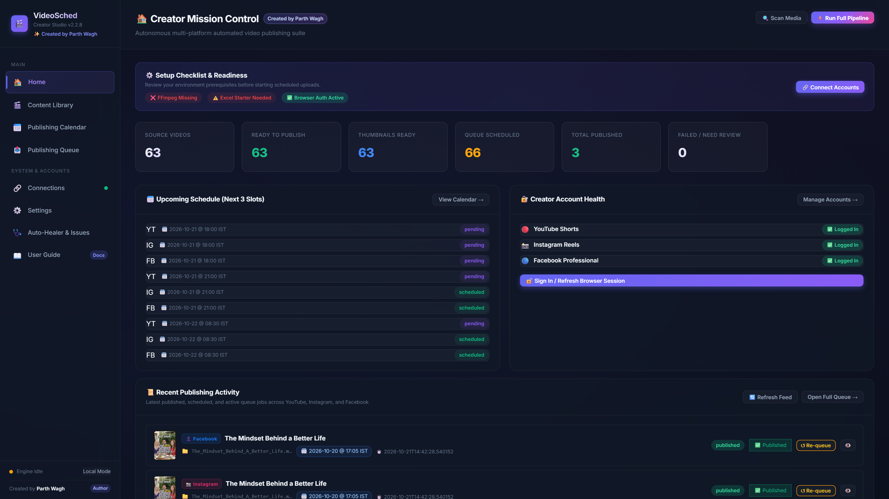
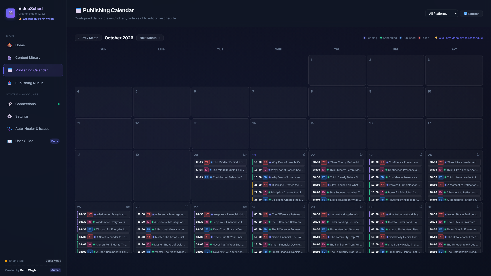
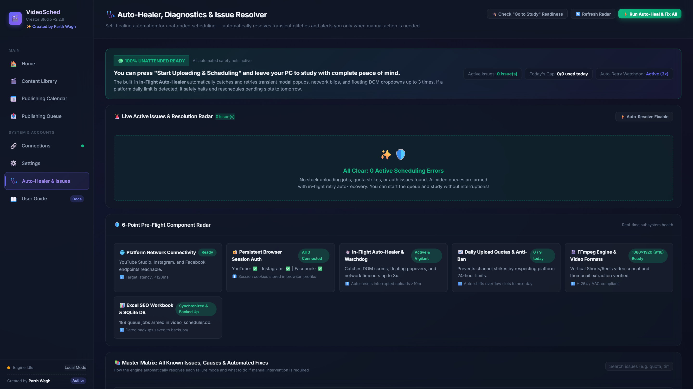
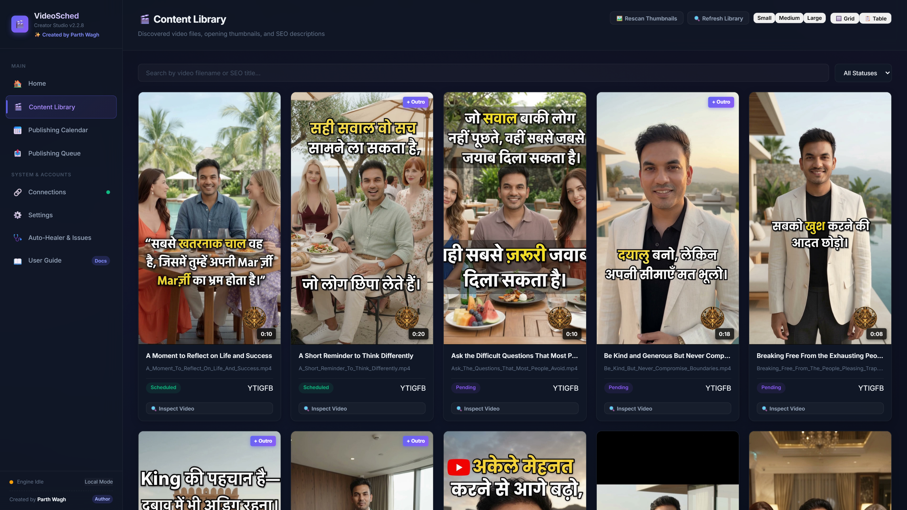
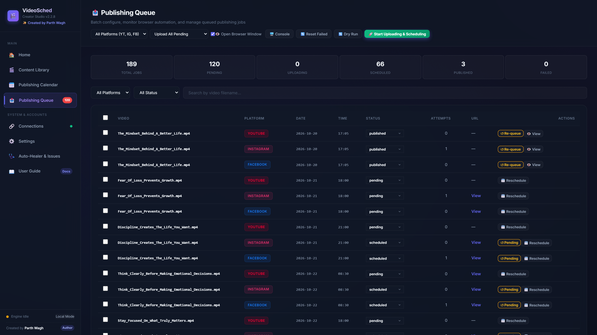
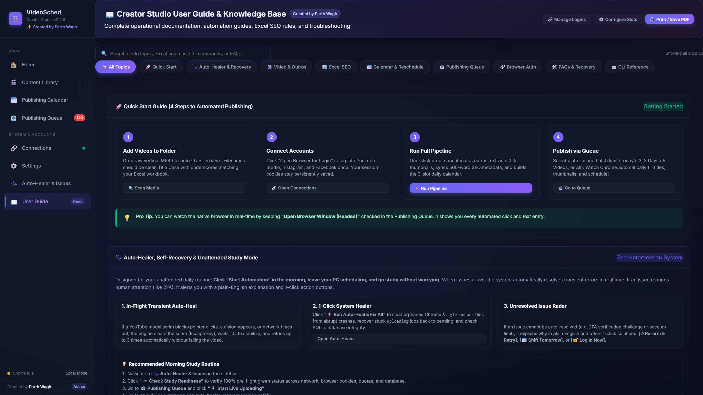

# 🎬 Video Scheduling — Creator Studio

> **A standalone, privacy-first, browser-automation video scheduling and publishing suite for content creators.**  
> Effortlessly prepare, brand, and schedule vertical short-form videos across **YouTube Shorts**, **Instagram Reels**, and **Facebook Reels** with zero API fees, zero cloud telemetry, and 100% local control.  
> 
> **Created & Engineered by [Parth Wagh](https://github.com/parthwagh9999)**

[](https://github.com/parthwagh9999/Video-Scheduling/actions)
[](LICENSE)
[](https://www.python.org/)
[](https://playwright.dev/)
[](https://ffmpeg.org/)
[](ANTIGRAVITY.md)

---

## 🤖 100% Compatible with Google Antigravity

This repository is **fully optimized for Google Antigravity IDE and AI Pair Programming**.

You can directly add this entire folder into **Google Antigravity**, and Antigravity's agentic AI assistant can operate the entire suite on your behalf:
- Scan media directories and probe resolutions with FFmpeg.
- Concatenate outros and extract crisp `0.0s` opening frame thumbnails.
- Synchronize two-way metadata with Excel workbooks.
- Realign scheduling calendars across time slots.
- Run the in-flight Auto-Healer and Playwright browser publisher.
- Execute unit and integration test suites (`pytest tests/ -v`).

👉 **See the dedicated [Google Antigravity Playbook & Prompt (ANTIGRAVITY.md)](ANTIGRAVITY.md)** for copy-and-paste prompts you can give Antigravity to run your scheduling pipeline hands-free.

---

## 📸 Visual Showcase & Interface Tour

### 1. 🏠 Creator Mission Control
*Live pipeline terminal, quick media scanning, system telemetry, and one-click end-to-end automation execution.*


---

### 2. 📅 Publishing Calendar (3 Daily IST Slots)
*Interactive calendar organizing uploads into 08:30 (Morning), 18:00 (Evening Peak), and 21:00 (Night Prime) slots with 1-click slot rescheduling and platform sync.*


---

### 3. 🩺 Auto-Healer, Diagnostics & Unattended Study Mode
*Pre-flight radar, transient self-healing, stuck upload watchdog, and active unresolved issue radar with 1-click solutions.*


---

### 4. 🎬 Content Library & SEO Metadata
*Complete library view of discovered videos, 0.0s opening frame thumbnails, outro concatenation flags, and 500-word SEO metadata.*


---

### 5. 📤 Publishing Queue & Execution Controls
*Platform filters, safe batch limits (Today's 3 videos vs 3 Days / 9 videos), dry-run simulator, and live SSE streaming logs.*


---

### 6. 📖 Creator Studio User Guide & Knowledge Base
*Built-in interactive documentation, category filters, code snippets, and operational best practices.*


---

## 💡 What is Video Scheduling?

Publishing vertical short-form videos across YouTube Shorts, Instagram Reels, and Facebook Reels every single day is repetitive, time-consuming, and error-prone. Commercial schedulers require expensive monthly subscriptions, official API developer accounts with severe limits, and often compress video quality.

**Video Scheduling — Creator Studio** solves this by automating the exact desktop browser workflow a creator performs manually:
1. **Scans and indexes** your local video directory (`start video/`).
2. **Generates crisp opening frame thumbnails** (at `0.0s`) automatically via FFmpeg.
3. **Appends promotional outros** (alternating every second video or custom rules).
4. **Syncs metadata bidirectionally with Excel** (`YouTube_SEO_61_Videos_500_Word_Descriptions_FILENAME_MATCHED.xlsx`), managing 500-word SEO YouTube descriptions, 200-word Instagram/Facebook captions, and hashtags.
5. **Generates balanced publishing calendars** across 3 daily slots (**08:30**, **18:00**, and **21:00 IST**).
6. **Executes live browser publishing** into **YouTube Studio** and **Facebook / Instagram** using Playwright and your persistent Google Chrome profile.

---

## 🩺 The "Morning Study" Workflow & Auto-Healer

Built specifically for unattended scheduling: **Click "Start Automation" in the morning, leave your PC scheduling, and go study without worrying.**

```
                         [Morning: You click "Start Automation"]
                                         │
                                         ▼
                 ┌────────────────────────────────────────────────┐
                 │          Queue Publisher Processing            │
                 └───────────────────────┬────────────────────────┘
                                         │
                        ┌────────────────┴────────────────┐
                        │ Issue Detected During Upload?   │
                        └────────────────┬────────────────┘
                                         │
                    ┌────────────────────┴────────────────────┐
                    ▼                                         ▼
         [TRANSIENT / RECOVERABLE]                   [HARD BLOCKER / AUTH]
      - YouTube Modal/Scrim Block                   - 2FA Checkpoint Triggered
      - Chromium SingletonLock                      - Cookie/Session Expired
      - Temporary Network Drop                      - Channel Account Strike
                    │                                         │
                    ▼                                         ▼
   ┌─────────────────────────────────┐       ┌─────────────────────────────────┐
   │    Automated In-Flight Heal     │       │   Marked with Clear Reason      │
   │ 1. Clears scrims (Escape key)   │       │ 1. Badged on Sidebar with "1"   │
   │ 2. Cooldown delay (10s)         │       │ 2. Actionable diagnosis shown   │
   │ 3. Retries up to 3x             │       │ 3. 1-Click Fix Button offered:  │
   │ 4. If Quota hit: shifts to tmrw │       │    [Re-arm] [Shift] [Log In]    │
   └─────────────────────────────────┘       └─────────────────────────────────┘
                    │                                         │
                    ▼                                         ▼
            [VIDEO PUBLISHED]                       [SAFE STATE PRESERVED]
         (No human intervention)                 (Other queue jobs keep running)
```

### Master Knowledge Matrix (7 Core Platform Issues)

| # | Failure Mode | Root Cause | Automated Self-Healing Resolution |
| :-: | :--- | :--- | :--- |
| **1** | **YouTube Daily Limit** (`daily upload limit reached`) | Unverified channels capped at ~10–15 Shorts per 24 hours. | Engine detects quota banner, halts daily submissions, and auto-shifts pending queue slots to tomorrow. |
| **2** | **Modal Scrim / Click Block** (`pointer-events: none`) | YouTube animation or backdrop blocks Playwright pointer clicks. | Auto-presses `Escape` key, waits 10s stabilization cooldown, and retries the click sequence up to 3x. |
| **3** | **2FA / Cookie Expiry** (`Login challenge required`) | Instagram or Google security session token expired. | Flags as non-transient, isolates job so queue continues, and provides 1-click `[🔓 Log In Now]` launcher. |
| **4** | **Windows Sleep Mode** (Stuck in `uploading`) | Windows power-saving suspended CPU and network mid-stream. | Watchdog detects jobs in `uploading` state >10 minutes and resets them cleanly back to `pending`. |
| **5** | **Network Idle Timeout** (`net::ERR_TIMED_OUT`) | Studio asset upload took longer than 60s timeout. | Flushes Chromium socket cache, verifies connectivity, and retries with progressive backoff. |
| **6** | **Singleton Lockfile** (`SingletonLock in browser_profile`) | Chromium abruptly stopped without flushing lock files. | 1-Click Auto-Heal automatically unlinks orphaned `SingletonLock` and `SingletonCookie` files. |
| **7** | **Excel Metadata Drift** (Missing or shifted columns) | User manually edited Excel structure or removed required headers. | Two-way validator verifies all 11 required columns and restores backups from `backups/`. |

---

## 🌟 Key Features & Capabilities

| Capability | Description |
| ---------- | ----------- |
| 🌐 **Pure Browser Automation** | Uses Playwright with a persistent Chrome profile (`browser_profile/`). You sign in once, and all subsequent sessions reuse your authenticated cookies. |
| ⏰ **3 Daily Fixed Slots** | Automatically allocates scheduled posts at **08:30**, **18:00**, and **21:00 IST**, enforcing a safe upload pacing cap of **9 videos/day per platform** (scheduling up to 3 days ahead). |
| 📊 **Excel Synchronization** | Two-way synchronization with Excel (`openpyxl`) featuring automatic column validation and timestamped backups before every write in `backups/`. |
| 🎞️ **Smart FFmpeg Outros** | Automatically concatenates outro call-to-action clips (`End Video/`) to alternating videos without quality degradation. |
| 🖼️ **0.0s Frame Thumbnails** | Extracts precise opening frames as high-res thumbnails for YouTube Shorts and Instagram/Facebook Reels. |
| 💻 **Creator Mission Control** | Glassmorphic dark-mode web dashboard featuring live system metrics, onboarding checklist, interactive monthly calendar, and live terminal console. |
| 🛡️ **Account Safety Pacing** | Deliberate 5–10s human pacing delays between uploads and visible browser execution to protect your account health. |
| 🔒 **100% Privacy & Security** | Binds strictly to `127.0.0.1:8899`. Video files, thumbnails, cookies, passwords, and spreadsheets never leave your computer. |

---

## 🚀 Quickstart & Installation

### Windows (Recommended)
1. Ensure **Python 3.10+** is installed (check ☑ *"Add Python to PATH"* during install).
2. Install **FFmpeg** (e.g. `choco install ffmpeg-full` or download from [gyan.dev](https://www.gyan.dev/ffmpeg/builds/)).
3. Clone this repository:
   ```powershell
   git clone https://github.com/parthwagh9999/Video-Scheduling.git
   cd Video-Scheduling
   ```
4. Double-click **`Launch_GUI.bat`** (or `start_dashboard.bat`) to launch the application!  
   *(The server starts and automatically opens http://127.0.0.1:8899 in your default browser)*

### Cross-Platform (macOS / Linux)
```bash
git clone https://github.com/parthwagh9999/Video-Scheduling.git
cd Video-Scheduling

python3 -m venv venv
source venv/bin/activate
pip install -r requirements.txt
playwright install chromium

# Launch the Dashboard
python launch_gui.py
```

---

## 🔑 One-Time Account Setup

To allow browser automation to publish on your behalf:
1. Open the dashboard at `http://127.0.0.1:8899`.
2. Navigate to the **Connections** page.
3. Click **"🔓 Open Browser for Login"**. A Google Chrome window will launch.
4. Log into your accounts:
   - **YouTube Studio**: [studio.youtube.com](https://studio.youtube.com)
   - **Facebook Professional**: [facebook.com/professional_dashboard](https://www.facebook.com/professional_dashboard)
   - **Instagram**: [instagram.com](https://www.instagram.com)
5. Complete any 2-factor authentication (2FA) or captcha prompts.
6. Click **"✅ Close Browser & Save Session"**. Your authenticated session cookies stay stored in `browser_profile/` locally.

---

## 📁 Media & Metadata Preparation

```
Video Scheduling/
├── start video/                 # 📂 Drop your raw vertical videos here (.mp4, .mov)
│   ├── Leadership_Mindset_And_Daily_Habits.mp4
│   └── The_Power_Of_Focus_And_Discipline.mp4
├── End Video/                   # 📂 (Optional) Place outro CTA video here (.mp4)
│   └── End Video.mp4
├── output/
│   ├── processed/               # 🎬 Rendered videos with outros attached
│   └── thumbnails/              # 🖼️ Extracted 0.0s frame thumbnails
├── backups/                     # 🛡️ Automated timestamped Excel backups
├── browser_profile/             # 🔐 Your local Chrome login cookies (Never committed)
└── YouTube_SEO_61_Videos_500_Word_Descriptions_FILENAME_MATCHED.xlsx
```

### Video Naming Rules
- Use clean, title-case words separated by underscores or spaces:  
  ✅ `Leadership_Mindset_And_Daily_Habits.mp4`  
  ❌ `vid_1_final_v2_1080p.mp4`
- Avoid numbers in filenames for cleaner SEO and automated title generation.

---

## ⌨️ Command-Line Interface (CLI)

```bash
# Start FastAPI Web Dashboard
python launch_gui.py

# Scan video files and media directory
python run.py scan

# Synchronize Excel metadata workbook with automatic backup
python run.py sync

# Process videos and append outros (alternating rule)
python run.py process --rule every_second

# Generate scheduling calendar queue
python run.py schedule

# Run automated publishing (dry-run mode, 3 videos)
python run.py publish --limit 3 --dry-run

# Live publish to YouTube Studio (headed browser, 3 videos)
python run.py publish --platform youtube --limit 3 --headed
```

---

## 🧪 Testing Strategy

The repository includes a comprehensive automated test suite with **38 unit and integration tests** validating scheduling calculations, timezones, database transactions, Excel parsing, FFmpeg outro alternation, diagnostics, and API routes:

```bash
pytest tests/ -v
```

Automated tests run on every push and pull request via [GitHub Actions](.github/workflows/ci.yml) across Python 3.10, 3.11, 3.12, and 3.13 on both Windows and Linux.

---

## 🔒 Security & Privacy Guarantee

- **Zero Cloud Telemetry**: Everything executes strictly on `127.0.0.1:8899`.
- **Zero API Keys**: No paid APIs, developer tokens, or third-party webhooks required.
- **Protected Credentials**: `browser_profile/`, `.env`, tokens, database files, and raw media are strictly ignored in `.gitignore` and never committed.
- **Non-Destructive Excel Sync**: Automated timestamped backups are created in `backups/` before any write operation.

---

## 📚 Complete Documentation

- 📦 [Installation Guide](docs/INSTALLATION.md) — Detailed setup for Windows, macOS, and Linux.
- 📖 [Creator User Guide](docs/USER_GUIDE.md) — Complete UI walkthrough, metadata format, and workflows.
- 🤖 [Google Antigravity Guide](ANTIGRAVITY.md) — How to drop this project into Google Antigravity and prompt it.
- 🏛️ [System Architecture](docs/ARCHITECTURE.md) — Technical diagrams, concurrency locks, and database schema.
- 🔧 [Troubleshooting Manual](docs/TROUBLESHOOTING.md) — Solutions for common issues, lock recovery, and FFmpeg tips.
- 🤝 [Contributing Guidelines](CONTRIBUTING.md) — How to contribute code, run tests, and open PRs.
- 🔒 [Security & Privacy Policy](SECURITY.md) — Privacy guarantee and vulnerability reporting.

---

## 👨‍💻 Author

**Parth Wagh** ([@parthwagh9999](https://github.com/parthwagh9999))  
Creator & Lead Developer of Video Scheduling — Creator Studio

---

## 📄 License

This project is open-source software licensed under the **[MIT License](LICENSE)**.
