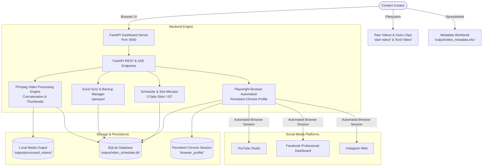

# 🏛️ Technical Architecture & System Design

This document details the software architecture, concurrency model, data flow, and database schema of **Video Scheduling — Creator Studio**.

---

## 📐 System Architecture Diagram



---

## 🧩 Core Architectural Components

### 1. Dynamic Configuration (`config/settings.py`)
- Automatically detects `PROJECT_ROOT` relative to file hierarchy (`Path(__file__).resolve().parent.parent`).
- Resolves all media directories (`start video/`, `End Video/`, `output/`, `browser_profile/`) portably across Windows, Linux, and macOS without machine-specific hardcoded paths.
- Allows optional environment variable overrides via `.env`.
- Auto-detects `ffmpeg` and `ffprobe` binaries in system `PATH`.

### 2. Video Processing Engine (`app/video/processor.py`)
- **Probing**: Uses `ffprobe` to validate video dimensions, aspect ratio (9:16 vertical), duration, codec, and framerate.
- **Thumbnail Extraction**: Extracts frame `0.0s` via FFmpeg fast seek (`-ss 00:00:00 -vframes 1`) without re-encoding the entire video.
- **Outro Concatenation**: Appends an outro call-to-action clip according to configurable rules (`every_second`, `every`, `none`) using FFmpeg's concat filter (`[0:v][0:a][1:v][1:a]concat=n=2:v=1:a=1[v][a]`). Re-encoding is performed with `-c:v libx264 -preset fast -crf 22 -c:a aac -b:a 192k`.

### 3. Excel Metadata Synchronization (`app/excel/sync.py`)
- Employs `openpyxl` with strict pre-write automated backups saved into `backups/` before any file modification.
- **Resilient Header Matching**: Tolerates case and formatting variations across columns (e.g. `filename`, `File Name`, `video_file`).
- **Starter Workbook Generation**: If no workbook is present, `ensure_starter_workbook_if_missing()` dynamically generates a formatted Excel template with sample rows and column headers.

### 4. Scheduling Engine (`app/scheduler/engine.py`)
- Maintains 3 fixed daily publishing slots:
  - **🌅 Slot 1**: 08:30 IST
  - **🌆 Slot 2**: 18:00 IST
  - **🌙 Slot 3**: 21:00 IST
- Respects a daily upload cap of **9 videos/day** (scheduling up to 3 days in advance per batch).
- Implements conflict prevention and multi-platform schedule synchronization.

### 5. Playwright Browser Automation (`app/browser/publisher.py`)
- **Persistent Profile Architecture**: Launches Chromium/Chrome using `launch_persistent_context(user_data_dir=BROWSER_PROFILE_DIR)`. Cookies, sessions, local storage, and login states persist across runs.
- **No Headless Captchas**: Interactive login is performed in standard headed browser windows so users can solve 2FA or security challenges natively.
- **Account Health Pacing**: Implements deliberate 5–10 second pacing delays between sequential uploads to avoid platform bot triggers.
- **Platform Workflows**:
  - **YouTube Shorts**: Navigates to YouTube Studio, uploads file, sets title, inserts 500-word SEO description, sets visibility to *Scheduled*, selects date and time, and clicks schedule.
  - **Facebook Professional**: Uses the Meta Professional Dashboard Bulk/Reels uploader (`facebook.com/professional_dashboard/content/content_library/`) to upload video, enter caption with viral hashtags, enable Instagram auto-cross-posting, and commit the scheduled time.

### 6. Concurrency & Mutex Safety (`app/dashboard/server.py`)
- **Browser Lock Protection**: Chrome Playwright instances cannot run concurrently on the same `browser_profile` folder without corruption. The server enforces `queue_publish_lock` and rejects overlapping publishing requests with HTTP 409 Conflict.
- **Real-Time Streaming**: Uses Server-Sent Events (SSE) (`/api/pipeline/run-all` and `/api/queue/publish/stream`) so long-running operations stream live log lines to the frontend without blocking the HTTP server.

---

## 🗄️ Database Schema (`video_scheduler.db`)

```sql
-- Discovered source videos
CREATE TABLE source_videos (
    id INTEGER PRIMARY KEY AUTOINCREMENT,
    filename TEXT UNIQUE NOT NULL,
    filepath TEXT NOT NULL,
    duration_seconds REAL,
    file_size_bytes INTEGER,
    width INTEGER,
    height INTEGER,
    fps REAL,
    outro_appended INTEGER DEFAULT 0,
    output_filename TEXT,
    thumbnail_path TEXT,
    validation_passed INTEGER DEFAULT 1,
    created_at TIMESTAMP DEFAULT CURRENT_TIMESTAMP
);

-- Synchronized Excel metadata
CREATE TABLE excel_records (
    id INTEGER PRIMARY KEY AUTOINCREMENT,
    filename TEXT UNIQUE NOT NULL,
    seo_title TEXT,
    description TEXT,
    instagram_caption TEXT,
    hashtags TEXT,
    status TEXT DEFAULT 'pending',
    scheduled_date TEXT,
    scheduled_time TEXT,
    youtube_url TEXT,
    raw_data JSON,
    synced_at TIMESTAMP DEFAULT CURRENT_TIMESTAMP
);

-- Scheduled publishing jobs
CREATE TABLE publishing_jobs (
    id INTEGER PRIMARY KEY AUTOINCREMENT,
    source_filename TEXT NOT NULL,
    platform TEXT NOT NULL,          -- 'youtube', 'instagram', 'facebook'
    status TEXT DEFAULT 'pending',   -- 'pending', 'uploading', 'scheduled', 'published', 'failed'
    scheduled_date TEXT NOT NULL,
    scheduled_time TEXT NOT NULL,
    attempt_count INTEGER DEFAULT 0,
    last_error TEXT,
    published_url TEXT,
    post_id TEXT,
    created_at TIMESTAMP DEFAULT CURRENT_TIMESTAMP,
    updated_at TIMESTAMP DEFAULT CURRENT_TIMESTAMP,
    UNIQUE(source_filename, platform, scheduled_date, scheduled_time)
);

-- Audit log
CREATE TABLE publishing_logs (
    id INTEGER PRIMARY KEY AUTOINCREMENT,
    job_id INTEGER,
    timestamp TIMESTAMP DEFAULT CURRENT_TIMESTAMP,
    action TEXT NOT NULL,
    platform TEXT,
    status TEXT,
    details TEXT
);
```
